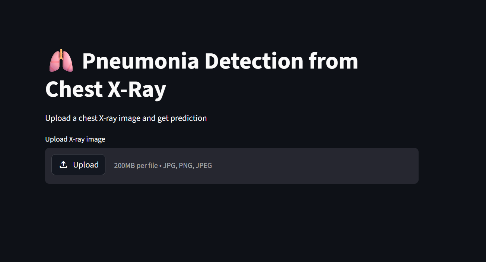

# 🫁 Pneumonia Detection from Chest X-Rays

[](https://github.com/Abhhiiissshhek/pneumonia-detection/actions/workflows/ci.yml)


[](LICENSE)
[](https://colab.research.google.com/github/Abhhiiissshhek/pneumonia-detection/blob/main/notebooks/train_colab.ipynb)

An end-to-end deep learning project that classifies chest X-rays as **Normal** or **Pneumonia** using transfer learning on **ResNet18**. It explains each prediction with **Grad-CAM** and serves the model through a **Streamlit** web app.

It covers the whole ML lifecycle: a reproducible data pipeline, class-imbalance-aware training, honest evaluation on a held-out test set, explainability, a tested inference API, CI and Docker.

<p align="center">
  
</p>

---

## ✨ Highlights

- **Transfer learning:** ImageNet-pretrained ResNet18. You can fine-tune only the head, the last residual block (default), or the whole network.
- **Handles class imbalance:** the data is about 3:1 Pneumonia to Normal, so the loss is weighted by inverse class frequency.
- **Recall-first decision threshold:** missing pneumonia is worse than a false alarm. Training lowers the threshold (from 0.5) until validation recall reaches a target (default 95%) and stores it in the checkpoint.
- **No data leakage:** a stratified, seeded validation split comes from `train/`. The official `test/` set is used only for final evaluation.
- **Explainability:** Grad-CAM heatmaps show which lung regions drove each prediction. It's implemented from scratch with PyTorch hooks.
- **Full evaluation report:** accuracy, precision, recall (sensitivity), specificity, F1, ROC-AUC, a confusion matrix and a ROC curve.
- **Streamlit app:** confidence score, adjustable threshold, Grad-CAM overlay and validation metrics. Weights download automatically from GitHub Releases.
- **Engineering:** installable package, CLI tools, 19 pytest tests (including an end-to-end pipeline and app tests), GitHub Actions CI, ruff and a Dockerfile.

## 📊 Results

Evaluated on the **official held-out test set** (624 images: 234 Normal, 390 Pneumonia) with `python -m pneumonia.evaluate`.

| Metric | Score |
|---|---:|
| Accuracy | _run evaluate_ |
| Recall / sensitivity (Pneumonia) | _run evaluate_ |
| Specificity (Normal) | _run evaluate_ |
| Precision | _run evaluate_ |
| F1 | _run evaluate_ |
| ROC-AUC | _run evaluate_ |

> Fill this table from `reports/metrics.json` after training. Then copy `reports/confusion_matrix.png`, `reports/roc_curve.png` and a Grad-CAM example into `docs/` and embed them here.
>
> **Why recall matters:** in screening, a false negative (missed pneumonia) is far more costly than a false positive, which a radiologist can quickly dismiss.

## 🧠 How it works

```text
X-ray ─► Grayscale→3ch ─► Resize 224 ─► Normalize ─► ResNet18 backbone ─► Dropout ─► Linear(512→2)
                                                        │                            │
                                                        └── layer4 ── Grad-CAM ──┐   └── softmax ─► P(pneumonia) ≥ threshold?
                                                                                 ▼
                                                                         heatmap overlay
```

| Component | Choice |
|---|---|
| Backbone | ResNet18, ImageNet weights |
| Trainable | `layer4` + classifier (`--finetune head\|layer4\|all`) |
| Loss | Class-weighted cross-entropy |
| Optimizer | AdamW (lr 3e-4, weight decay 1e-4), cosine LR schedule |
| Augmentation | Horizontal flip, small rotation, translation and scale |
| Model selection | Best validation ROC-AUC, early stopping (patience 3) |
| Threshold | Lowered from 0.5 until validation recall ≥ 95% |

## 📁 Project structure

```text
pneumonia-detection/
├── app.py                     # Streamlit web app
├── src/pneumonia/
│   ├── config.py              # paths, constants
│   ├── data.py                # transforms, stratified split, loaders
│   ├── model.py               # ResNet18 builder, legacy-checkpoint loading
│   ├── train.py               # training CLI
│   ├── evaluate.py            # test-set evaluation + plots
│   ├── predict.py             # Predictor class + CLI
│   ├── gradcam.py             # Grad-CAM implementation
│   ├── metrics.py             # metrics, threshold selection
│   └── utils.py               # seeding, device, checkpoint I/O
├── tests/                     # pytest suite (synthetic data, runs on CPU in seconds)
├── notebooks/train_colab.ipynb
├── scripts/download_data.sh
├── .github/workflows/ci.yml
├── Dockerfile
└── pyproject.toml
```

## ⚙️ Setup

```bash
git clone https://github.com/Abhhiiissshhek/pneumonia-detection.git
cd pneumonia-detection
python -m venv .venv
source .venv/bin/activate        # Windows: .venv\Scripts\activate
pip install -e ".[dev]"
```

### Dataset

[Chest X-Ray Images (Pneumonia)](https://www.kaggle.com/datasets/paultimothymooney/chest-xray-pneumonia) on Kaggle, about 5,800 pediatric chest X-rays.

```bash
pip install kaggle               # needs ~/.kaggle/kaggle.json
bash scripts/download_data.sh    # → data/chest_xray/{train,val,test}
```

## 🚀 Usage

**No GPU?** Use the [Colab notebook](notebooks/train_colab.ipynb). It downloads the data, trains, evaluates and exports the weights on a free T4 GPU in about 15 minutes.

```bash
# Train (saves models/pneumonia_resnet18.pt and reports/training_history.json)
python -m pneumonia.train --epochs 10

# Evaluate on the held-out test set (writes reports/metrics.json + plots)
python -m pneumonia.evaluate

# Predict on images, optionally saving a Grad-CAM overlay
python -m pneumonia.predict path/to/xray.jpeg --gradcam gradcam.png

# Web app
streamlit run app.py
```

Run `python -m pneumonia.train --help` to see every option (learning rate, fine-tuning mode, target recall, device and more).

Use it from Python:

```python
from PIL import Image
from pneumonia.predict import Predictor

predictor = Predictor("models/pneumonia_resnet18.pt")
pred = predictor.predict(Image.open("xray.jpeg"))
print(pred.label, pred.pneumonia_probability)
predictor.gradcam(Image.open("xray.jpeg")).save("cam.png")
```

## 🌐 Deployment

The trained checkpoint (~45 MB) is not committed. Publish it as an asset named `pneumonia_resnet18.pt` on a [GitHub Release](https://github.com/Abhhiiissshhek/pneumonia-detection/releases). If no local weights exist, the app downloads them from the latest release on startup. You can override this with the `MODEL_PATH` or `MODEL_URL` environment variables.

- **Streamlit Community Cloud:** point it at `app.py`. It installs `requirements.txt`.
- **Docker:**
  ```bash
  docker build -t pneumonia-detection .
  docker run -p 8501:8501 pneumonia-detection
  ```

## 🧪 Tests

```bash
pytest          # 19 tests, ~10 s on CPU
ruff check .
```

The tests generate a small synthetic dataset, so they need neither the real data nor a GPU. They cover:
- the data split (stratified, disjoint and reproducible)
- model freezing and legacy-checkpoint loading
- the metrics and threshold logic
- a full train → evaluate → predict → Grad-CAM run
- the Streamlit app, with and without a model

## ⚠️ Limitations

- The dataset is pediatric (ages 1–5) from a single hospital in Guangzhou, so the model may not generalize to adults or other scanners.
- The official validation split has only 16 images, so a split carved out of `train/` is used instead.
- This is an educational project, **not a medical device**.

## 🔮 Future work

- Compare against DenseNet121 and EfficientNet-B0
- Bacterial vs viral pneumonia (3-class)
- Test-time augmentation and probability calibration
- External validation on another dataset (e.g. RSNA Pneumonia Detection)

## 👨‍💻 Author

**Abhishek Prajapati**, BS Data Science, IIT Madras
[GitHub](https://github.com/Abhhiiissshhek) · [LinkedIn](https://www.linkedin.com/in/abhishekprajapati-ml)

Licensed under the [MIT License](LICENSE).
